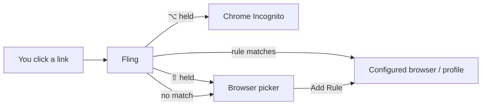

# Fling

**A tiny macOS browser router.** Set Fling as your default browser and every link you click gets sent to the right browser or profile, automatically.

Work links open in your work Chrome profile, personal links open in your personal one, and anything Fling doesn't recognise pops up a small picker so you can choose (and remember the choice).

- 🪶 Lives in the menu bar, no Dock icon, no main window
- ⚡ Matched links are dispatched silently, nothing pops up
- 🧭 Domain, path and regex rules, e.g. `github.com/yourname` → Personal, everything else on `github.com` → Work
- 👤 Chrome, Brave and Edge profile targets (`--profile-directory`)
- 🕶️ Hold ⌥ Option to open a link in Chrome Incognito
- 🎯 Hold ⇧ Shift to skip your rules and pick a browser for one link
- 📝 Plain JSON config you can edit by hand

## How it works



### Rules

Rules are checked from top to bottom and the first match wins, with one exception: a domain rule limited to a path beats a broader rule for the same link, whatever order they're in.

| Rule                                         | Matches                                                                                     |
| -------------------------------------------- | ------------------------------------------------------------------------------------------- |
| `github.com`                                 | `github.com/anything`, plus `gist.github.com/...` if "Match subdomains" is on               |
| `github.com/yourname`                        | `github.com/yourname` and `github.com/YourName/repo/pull/1`, but not `github.com/yournamex` |
| `localhost:3000`                             | Only that port on localhost                                                                 |
| Regex `^https://docs\.example\.com/internal` | Anything the pattern matches in the full URL                                                |

Path matching is per segment and case-insensitive. You can paste a full link into the Domain field and Fling trims it down for you.

### The picker

When no rule matches, a small floating panel shows your targets as large icons (press 1–9 to pick). From there you can copy the link, open it in Chrome Incognito, or add a rule so you're not asked again.

## Requirements

- macOS 14 Sonoma or later
- Xcode 16 or later
- [XcodeGen](https://github.com/yonaskolb/XcodeGen) and [mise](https://mise.jdx.dev)

```bash
brew install xcodegen mise
```

## Install

### Download

Grab the latest `.dmg` or `.zip` from [Releases](https://github.com/reefbarman/fling/releases) and drag Fling into Applications. Builds are universal (Apple Silicon and Intel).

Releases aren't notarised by Apple yet, so the first launch shows **"Fling" Not Opened**. Click **Done**, then either:

- open **System Settings → Privacy & Security**, scroll to *"Fling" was blocked to protect your Mac*, click **Open Anyway** and confirm, or
- run this in Terminal, then open Fling normally:

  ```bash
  xattr -dr com.apple.quarantine /Applications/Fling.app
  ```

You only need to do this once per download. (On macOS 14, right-click Fling and choose **Open** also works.)

### From source

```bash
git clone https://github.com/reefbarman/fling.git
cd fling
mise run install
```

This builds a Release copy, installs it to `/Applications/Fling.app`, registers it with Launch Services and launches it.

### Make it your default browser

Open **Settings → General** from the Fling menu bar icon and click **Make Default…** (or pick Fling under *System Settings → Desktop & Dock → Default web browser*).

On first launch Fling detects your installed browsers and Chrome profiles and creates targets for them.

## Settings

Open Settings from the menu bar icon (⌘,).

- **Rules:** add, edit, filter, turn on/off and drag to reorder
- **Targets:** the browsers and profiles links can open in, in picker order
- **Test a Link:** paste a link to see which rule and target it would hit, without opening anything
- **General:** default browser status, open at login, shortcuts and the config file location

## Configuration

Everything lives in `~/Library/Application Support/Fling/config.json`. You can edit it directly and choose **Reload Config** from the menu bar.

```json
{
  "version": 1,
  "preferences": { "launchAtLogin": true },
  "targets": [
    {
      "id": "work",
      "displayName": "Work",
      "bundleIdentifier": "com.google.Chrome",
      "applicationName": "Google Chrome",
      "profile": { "profileDirectory": "Default", "profileName": "Work" },
      "isEnabled": true
    },
    {
      "id": "personal",
      "displayName": "Personal",
      "bundleIdentifier": "com.google.Chrome",
      "applicationName": "Google Chrome",
      "profile": { "profileDirectory": "Profile 1", "profileName": "Personal" },
      "isEnabled": true
    }
  ],
  "rules": [
    {
      "type": "domain",
      "id": "github-personal",
      "name": "GitHub (personal)",
      "domain": "github.com/yourname",
      "matchSubdomains": false,
      "targetId": "personal",
      "enabled": true
    },
    {
      "type": "domain",
      "id": "github",
      "domain": "github.com",
      "matchSubdomains": true,
      "targetId": "work",
      "enabled": true
    }
  ],
  "chromeProfileOverrides": []
}
```

Chrome profile folder names (`Default`, `Profile 1`, …) are listed in `chrome://version` under *Profile Path*.

## Development

```bash
mise run generate   # regenerate Fling.xcodeproj from project.yml
mise run build      # Debug build
mise run open       # open the Debug build
mise run start      # clean + generate + build + open
mise run release    # Release build
mise run install    # Release build installed to /Applications
```

- `project.yml` is the source of truth. `Fling.xcodeproj` is generated and not committed, so run `mise run generate` after cloning and whenever you add files.
- Debug builds use the bundle id `com.tristan.fling.debug`, so they never take over link handling from the installed copy.
- `open build/DerivedData/Build/Products/Debug/Fling.app --args -FlingOpenSettingsOnLaunch YES` opens Settings straight away.
- `Scripts/package-release.sh 1.2.3` builds the release zip and dmg into `dist/`, exactly as CI does.
- See [`AppBundle/ManualTesting.md`](AppBundle/ManualTesting.md) for manual test scenarios and [`CLAUDE.md`](CLAUDE.md) for an architecture overview.

### Releasing

Push a version tag and the [Release workflow](.github/workflows/release.yml) builds, packages and publishes a GitHub release:

```bash
git tag v0.2.0 && git push origin v0.2.0
```

Tags with a suffix (`v0.2.0-beta.1`) are published as pre-releases. Builds are ad-hoc signed by default. To sign with a real certificate, add `MACOS_DEV_CERT_P12_BASE64` (a base64-encoded `.p12`) and `MACOS_DEV_CERT_PASSWORD` as secrets in the repo's `release` environment.

### Project layout

```text
Fling/
  App/              lifecycle, AppCoordinator (queue, routing, persistence)
  Domain/           models (targets, rules, config) and the routing engine
  Features/         SwiftUI views: settings, selector, rule and target editors
  Infrastructure/   browser launching and discovery, config store, windows, menu bar
AppBundle/          Info.plist (URL handler registration) and assets
```

## Caveats

- **Modifier keys are best-effort.** macOS doesn't pass the original click's modifier keys along with the URL, so Fling reads the keyboard state when the link arrives. If you let go of ⌥ or ⇧ too quickly, it may be missed.
- **Profiles are up to the browser.** Fling launches Chromium browsers with `--profile-directory`. If a profile opens the wrong window, check the stored `profileDirectory` in the config before assuming Fling is at fault.

## License

[MIT](LICENSE)
