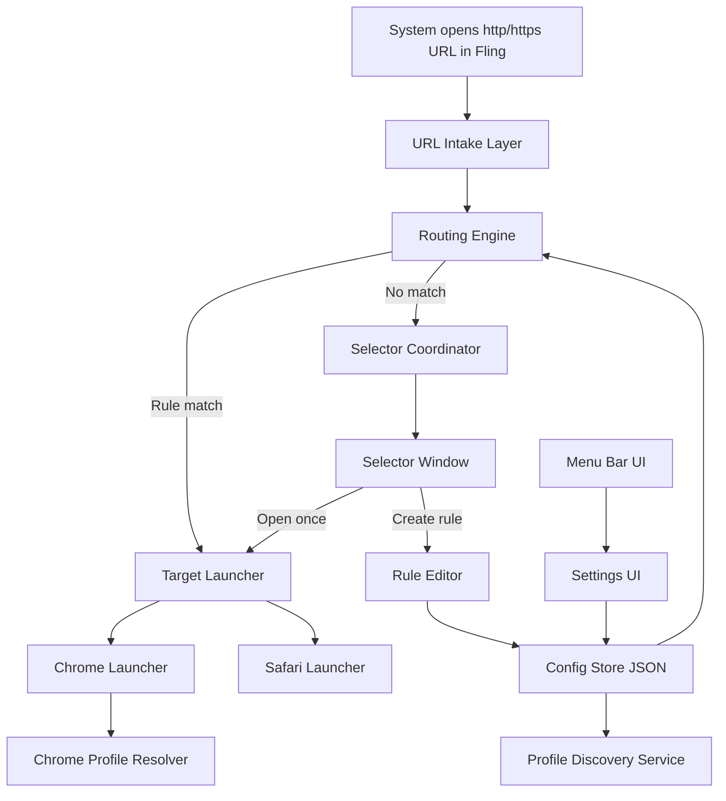
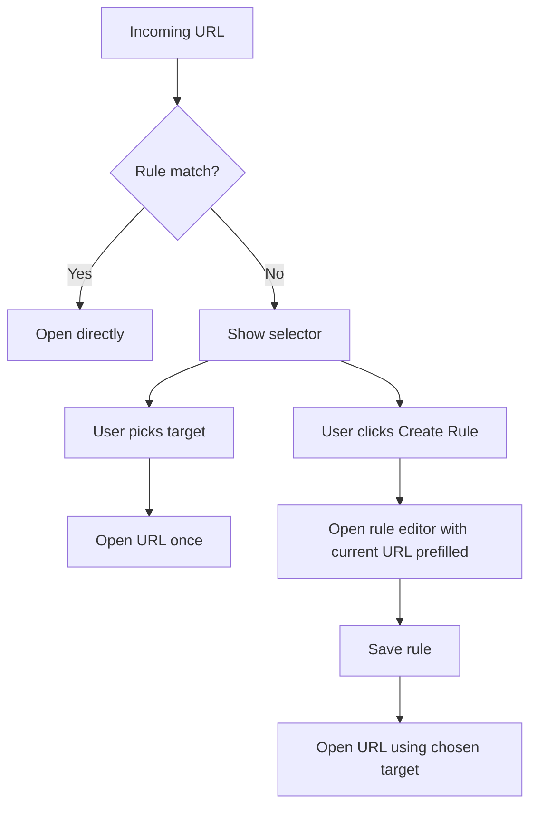

# Fling Browser Router Plan

## Goal

Build a native macOS app named **Fling** that can be set as the system default web browser, receive incoming URLs, evaluate configured routing rules, and then either:

1. open the URL directly in the configured destination browser/profile, or
2. present a small browser selector modal when no rule matches.

The selector should display configured browser/profile targets with icons and allow the user to:

- open the current URL once,
- copy the URL,
- create a new routing rule using the current URL as context.

Initial browser support:

- Safari
- Google Chrome
- Multiple Chrome profiles

Initial rule support:

- Domain-based rules
- URL-pattern rules using regular expressions

Persistence requirement:

- Human-editable local JSON configuration

Non-goals for v1:

- Browser extensions
- Cloud sync
- Cross-device syncing
- Firefox/Arc/Brave support
- Rules based on source application
- Advanced enterprise policy management

---

## Product Constraints and Assumptions

- Fling must behave as a valid macOS app capable of receiving `http` and `https` URLs as the default browser handler.
- The app should avoid browser extensions entirely.
- The first implementation is a local prototype for personal use, so we can optimize for correctness and maintainability over broad compatibility polish.
- Chrome profile support should be auto-detected where possible, with manual rename/cleanup in the UI.
- If multiple rules match, **most specific wins**, with URL regex rules taking precedence over domain rules.
- For Chrome profile launches, prefer reusing existing browser behavior/windows rather than forcing a new window strategy.

---

## Recommended Technical Stack

Use a **SwiftUI-first macOS app** with selective AppKit integration.

### Why SwiftUI-first

- Best fit for a modern native macOS prototype.
- Fastest path for settings, rule editor, selector UI, and menu bar integration.
- Works well with app lifecycle/state management in a small standalone product.

### Where AppKit is still needed

- Default browser / URL document handling details
- NSApplication activation and window management
- Presenting a compact modal/panel reliably on incoming URL events
- Menu bar status item behavior if SwiftUI abstractions are limiting
- Launch-at-login integration

---

## High-Level Architecture



### Core modules

1. **URL Intake Layer**
   - Receives inbound URLs from macOS when Fling is the default browser.
   - Normalizes/validates incoming URLs.
   - Converts events into app-level route requests.

2. **Routing Engine**
   - Evaluates rules deterministically.
   - Picks a single target or falls back to selector.
   - Encapsulates precedence and matching logic.

3. **Target Launcher**
   - Opens URLs in Safari or Chrome.
   - Handles Chrome profile targeting.
   - Centralizes all process launching and AppleScript/shell integration if needed.

4. **Profile Discovery Service**
   - Detects available Chrome profiles from local Chrome metadata.
   - Maps profile directories to user-facing names/icons.
   - Supports manual display-name cleanup/override in config.

5. **Config Store**
   - Reads/writes human-editable JSON.
   - Stores browser targets, Chrome profile metadata overrides, rules, app preferences.

6. **UI Layer**
   - Selector modal
   - Settings window
   - Rule editor window
   - Menu bar entry point

---

## Proposed Project Structure

```text
Fling/
  App/
    FlingApp.swift
    AppCoordinator.swift
    URLHandling/
      URLEventReceiver.swift
      IncomingURLContext.swift
  Domain/
    Models/
      BrowserTarget.swift
      BrowserKind.swift
      Rule.swift
      RuleMatchResult.swift
      AppConfig.swift
      ChromeProfile.swift
    Routing/
      RoutingEngine.swift
      URLMatcher.swift
      DomainMatcher.swift
      RegexMatcher.swift
  Infrastructure/
    Config/
      ConfigStore.swift
      ConfigFileLocator.swift
      JSONConfigCodec.swift
    Browsers/
      BrowserLauncher.swift
      SafariLauncher.swift
      ChromeLauncher.swift
      ChromeProfileDiscovery.swift
      ChromeMetadataReader.swift
    System/
      DefaultBrowserRegistrationNotes.md
      LaunchAtLoginManager.swift
      MenuBarController.swift
      WindowPresenter.swift
  Features/
    Selector/
      SelectorCoordinator.swift
      SelectorView.swift
      SelectorViewModel.swift
    Rules/
      RuleEditorView.swift
      RuleEditorViewModel.swift
    Settings/
      SettingsView.swift
      SettingsViewModel.swift
    Targets/
      TargetManagementView.swift
  Assets/
  Resources/
    SampleConfig.json
```

Exact file layout can be adjusted once the Xcode project is scaffolded, but the separation should remain: app lifecycle, domain logic, infrastructure, and feature UIs.

---

## URL Intake Design

### Requirement

When macOS opens a URL using Fling as the default browser, Fling must:

1. receive the URL,
2. survive cold start and startup timing races,
3. bring itself into the foreground only when needed,
4. route silently if a rule exists,
5. otherwise present the selector modal.

### Default browser registration and app lifecycle

This needs to be treated as a first-class implementation concern, not a side detail.

Fling should be designed as a real default browser handler using the correct macOS app metadata and intake path, including validation during early implementation.

Recommended direction:

- configure the app bundle with the required Info.plist entries for browser/default-handler behavior,
- declare handling for `http` and `https`,
- validate that the built app can actually be selected by macOS as the default browser and receives clicked links,
- use an AppKit-backed app delegate/coordinator path for URL intake rather than relying only on high-level SwiftUI hooks.

The exact plist keys and registration details should be verified during the first implementation slice before significant UI work continues.

### Startup and queueing behavior

When Fling is launched because the user clicked a link, the URL may arrive before all windows/coordinators are ready.

Recommended design:

- `AppCoordinator` owns an in-memory queue of pending URL route requests.
- inbound URLs are appended immediately on receipt.
- the coordinator drains the queue once config is loaded and the window-presentation layer is ready.
- selector presentation must be serialized so multiple simultaneous unmatched URLs do not fight over the same modal.

Recommended v1 behavior for multiple unmatched URLs:

- process them one at a time in arrival order.
- if a selector is already visible, additional URLs wait in the queue.

### Implementation approach

- Use a central `AppCoordinator` to receive and queue incoming URL events.
- Normalize the incoming URL before matching:
  - lowercase host for domain comparisons,
  - preserve the raw absolute URL string for exact regex matching,
  - compute a decoded display form for UI,
  - explicitly define whether fragments participate in matching,
  - reject malformed/unsupported URLs.

### URL normalization details

The app should distinguish between:

- **raw URL string** for launch fidelity,
- **normalized match form** for routing,
- **decoded display form** for UI.

Recommended v1 normalization rules:

- lowercase host,
- preserve path/query semantics,
- keep the raw URL available for browser launch,
- use a consistent normalized absolute string for regex rules,
- ignore URL fragments for domain rules,
- keep fragment handling explicit for regex rules by documenting that regex applies to the normalized absolute URL string.

### Important design choice

Domain matching in v1 should be explicit:

- `example.com` should match exactly `example.com` and optionally subdomains only if the rule says so.

Recommended v1 model:
- include a `matchSubdomains` boolean on domain rules.
- default it to `true` for convenience.

This is better than silently assuming all domain rules match subdomains forever.

---

## Rule System Design

### Rule types

#### 1. Domain rule

Example:

```json
{
  "id": "rule_docs",
  "type": "domain",
  "domain": "github.com",
  "matchSubdomains": true,
  "targetId": "chrome-work"
}
```

#### 2. URL regex rule

Example:

```json
{
  "id": "rule_linear_issue",
  "type": "urlRegex",
  "pattern": "^https://linear\\.app/myteam/issue/.*$",
  "targetId": "chrome-work"
}
```

### Rule precedence

Recommended precedence order:

1. first matching URL regex rule in config order
2. if none match, first matching domain rule in config order
3. fallback to selector

### Specificity within same rule type

Recommended v1 behavior:

- **config order is authoritative within a rule type**.
- users can reorder rules in the UI if needed.
- if explicit numeric priorities are needed later, add them in a future config version rather than inventing weak heuristics now.

For domain rules specifically, the matcher should still respect exact matching semantics and `matchSubdomains`, but once a rule is considered a match, config order should determine precedence among matching domain rules.

This is simpler and more predictable than trying to infer specificity from regex length or other proxies.

### Validation

Rule editor should validate:

- domain syntax
- regex compilation validity
- target existence
- duplicate/conflicting rule warnings

Warnings should not block save unless the rule is invalid.

---

## Browser Target Model

Model browser/profile destinations as explicit targets rather than encoding them inside rules.

### Target kinds

- Safari default target
- Chrome app target with a specific Chrome profile

### Example target config

```json
{
  "targets": [
    {
      "id": "safari",
      "kind": "safari",
      "displayName": "Safari"
    },
    {
      "id": "chrome-personal",
      "kind": "chrome",
      "displayName": "Chrome Personal",
      "profileDirectory": "Default",
      "profileDisplayName": "Personal"
    },
    {
      "id": "chrome-work",
      "kind": "chrome",
      "displayName": "Chrome Work",
      "profileDirectory": "Profile 1",
      "profileDisplayName": "Work"
    }
  ]
}
```

### Why targets should be first-class

- Rules can remain stable even if profile display labels change.
- Selector UI can show a clean list of configured launch destinations.
- Target management UI becomes straightforward.

---

## Chrome Profile Discovery Strategy

### Proposed approach

Auto-detect Chrome profiles by inspecting Chrome’s local profile metadata, then allow user overrides.

Recommended primary data source:

- `~/Library/Application Support/Google Chrome/Local State`

Specifically, parse Chrome’s JSON metadata and extract profile information from the profile cache data in that file.

Expected output:

- profile directory key (`Default`, `Profile 1`, etc.)
- detected profile display name
- avatar/index metadata if available for UI hints

### Design constraints

- Auto-detection is best-effort and may vary by Chrome version.
- The app must tolerate stale/missing profiles.
- Manual rename/hide should be stored in Fling config rather than editing Chrome files.
- v1 should explicitly target **Google Chrome stable** only; other Chrome-family variants can be added later.

### Fallback behavior

If profile discovery fails:

- still allow manual target creation with a profile directory string.

This keeps the prototype usable even if Chrome metadata parsing is brittle.

---

## Browser Launching Strategy

### Safari

Preferred approach:

- use `NSWorkspace` / Launch Services to open the URL specifically in Safari.

### Chrome with profile

This is the highest-risk platform integration area.

Recommended v1 strategy:

1. Treat Chrome profile launching as a separately proven integration, not a routine browser-open call.
2. Prototype multiple launch strategies immediately.
3. Keep the implementation behind an isolated launcher boundary so strategy changes do not affect the rest of the app.

### Practical note

Chrome profile targeting on macOS is not as cleanly exposed as standard browser selection.

A key limitation to account for explicitly:

- launch arguments such as `--profile-directory=...` may work on cold launch but are commonly ignored when Chrome is already running.

That means a simple `open -a "Google Chrome" --args ...` strategy is unlikely to be sufficient in the common case.

The implementation should evaluate a few approaches early, likely in this order:

- standard app-targeted URL opening for basic Chrome launches,
- direct process launch experiments for cold-start profile targeting,
- AppleScript-based control as the likely primary fallback or primary approach for already-running Chrome scenarios.

These behaviors need prototype verification early, especially for the “Chrome already running” case.

### Recommended implementation decision

Treat browser launching behind a protocol:

```swift
protocol BrowserLauncher {
    func open(_ url: URL, in target: BrowserTarget) throws
}
```

Then isolate profile-launch experiments inside `ChromeLauncher` so the rest of the app is unaffected.

---

## Selector UX Design

### Trigger

Show selector only when no rule matches, or optionally later for explicit “always ask” behavior if added.

If the selector is dismissed, Fling must not silently lose the URL.

Recommended v1 cancel behavior:

- keep the URL in a small in-memory pending queue until the user explicitly dismisses or resolves it,
- provide a visible retry path from the menu bar item,
- at minimum, copy the URL to the clipboard and surface a brief error/status message if the pending flow is abandoned.

### UI contents

Small modal window with:

- current URL/host preview
- configured targets shown as large icon buttons
- keyboard shortcuts (`1..9`, Enter on selection, Escape to cancel)
- action to copy URL
- action to create a new rule

### Interaction flow



### Rule creation from selector

When user chooses “Create Rule”:

- prefill current full URL
- derive suggested domain automatically
- let user choose between:
  - domain rule
  - regex URL rule
- require target selection in the same flow

This matches your desired behavior without overloading the selector itself with complex inline editing.

---

## Settings and Rule Editor Design

### Settings window sections

1. **Targets**
   - list configured browser/profile targets
   - add/remove/rename targets
   - refresh Chrome profile detection

2. **Rules**
   - list all rules
   - filter/search rules
   - create/edit/delete rules
   - indicate target and match type

3. **General**
   - config file location
   - launch at login toggle
   - optional selector behavior preferences

### Rule editor fields

For domain rule:
- domain
- match subdomains toggle
- target

For regex rule:
- regex pattern
- live validity state
- target

Shared:
- enabled/disabled toggle
- notes/label optional

---

## Config File Design

Use a single human-editable JSON file in v1.

### Recommended location

Store under Application Support but expose reveal/export behavior:

- canonical runtime path: `~/Library/Application Support/Fling/config.json`

Also include:
- “Reveal Config File” action in settings
- import/export later if needed

### Why not place the primary config in a random visible folder

- Application Support is standard for macOS apps.
- It avoids clutter.
- Human-editable is still satisfied if the user can reveal and edit it.

### Example config shape

```json
{
  "version": 1,
  "preferences": {
    "launchAtLogin": false
  },
  "targets": [
    {
      "id": "safari",
      "kind": "safari",
      "displayName": "Safari"
    },
    {
      "id": "chrome-work",
      "kind": "chrome",
      "displayName": "Chrome Work",
      "profileDirectory": "Profile 1",
      "profileDisplayName": "Work"
    }
  ],
  "rules": [
    {
      "id": "github-work",
      "type": "domain",
      "domain": "github.com",
      "matchSubdomains": true,
      "targetId": "chrome-work",
      "enabled": true
    },
    {
      "id": "linear-issues",
      "type": "urlRegex",
      "pattern": "^https://linear\\.app/acme/issue/.*$",
      "targetId": "chrome-work",
      "enabled": true
    }
  ],
  "chromeProfileOverrides": [
    {
      "profileDirectory": "Profile 1",
      "displayName": "Work",
      "hidden": false
    }
  ]
}
```

### Config update strategy

- Load config on app start.
- Persist atomically on changes.
- Optionally watch for external edits and reload with user-visible error reporting.
- Check the config `version` on load and reserve space for forward migrations.

For v1, file watching is optional; manual reload from settings is acceptable.

---

## Menu Bar and Launch-at-Login

### Menu bar item

Include a lightweight menu bar item for:

- opening settings
- opening rules
- reloading config
- refreshing Chrome profiles
- quitting Fling

This is useful because Fling is not a document-style app users will keep open constantly.

### Launch at login

Recommended implementation:

- use Apple’s modern ServiceManagement APIs suitable for login items in a non-App-Store local app where possible.

This should be encapsulated behind `LaunchAtLoginManager` to keep platform specifics isolated.

---

## Error Handling Strategy

### User-visible errors to account for

- invalid config JSON
- invalid regex in saved config
- target references a missing browser/profile
- Chrome profile no longer exists
- browser launch failure

### Behavior guidelines

- Prefer non-blocking warnings in settings for configuration problems.
- For a launch failure on an incoming URL, show a focused error dialog with fallback actions:
  - copy URL
  - open selector
  - retry in Safari

Do not silently drop URLs.

---

## Security / Permissions Considerations

Potentially relevant macOS considerations:

- AppleScript/browser automation may trigger automation permissions if used.
- Sandboxing could complicate browser/profile control; since this is a local prototype, do not optimize for App Store sandboxing yet.
- Mac App Store distribution is not a good near-term target for this design, especially if AppleScript/process-level browser control is required.

This aligns with your prototype scope.

---

## Testing Strategy

### Unit tests

Cover:

- domain matching behavior
- regex matching behavior
- rule precedence/tie-breaking
- config decoding/encoding
- URL normalization

### Integration/prototype tests

Cover manually first:

- app becomes default browser and receives links
- matching URL routes directly to Safari
- matching URL routes directly to Chrome target
- Chrome profile target opens in intended profile
- no-match URL shows selector
- selector can create rule and retry open

### Highest-risk verification first

The single highest-risk unknown is **reliably opening a URL in a specific Chrome profile on macOS**. This should be proven in the earliest implementation pass before polishing the rest of the UI.

---

## Implementation Phases

### Phase 1: App skeleton and config model

- Create Xcode macOS app project using SwiftUI.
- Validate the app’s default-browser/default-handler registration metadata and URL-delivery path as an explicit milestone.
- Define domain models for targets, rules, and app config.
- Implement JSON config load/save with a sample config.
- Add settings window shell and menu bar item.
- Add an `AppCoordinator` URL queue for cold-start and multi-URL intake.

### Phase 2: Routing engine

- Implement URL normalization.
- Implement domain and regex matchers.
- Implement deterministic precedence logic.
- Add unit tests for matching behavior.

### Phase 3: Browser launching proof of concept

- Implement Safari launcher.
- Prototype Chrome launcher strategies.
- Verify profile-specific launch behavior with real local Chrome profiles.
- Lock in the best viable launcher approach behind a protocol.

### Phase 4: URL intake and selector

- Register app as handler for `http`/`https`.
- Route inbound URLs through coordinator.
- Open directly on rule match.
- Present selector modal on no-match.
- Add quick open/copy actions.

### Phase 5: Rule editor and target management

- Build target management UI with discovered Chrome profiles.
- Build rule list/editor.
- Add “Create Rule” flow from selector.
- Save and reload config updates.

### Phase 6: Utilities and hardening

- Add launch at login.
- Add config reveal/reload affordances.
- Improve error handling and diagnostics.
- Add app icons and polish.

---

## Key Risks and Trade-offs

### 1. Chrome profile launch reliability

Risk:
- Chrome may not reliably honor profile routing in every launch scenario.

Mitigation:
- Validate multiple launch strategies early.
- Keep launcher implementation swappable.
- If profile routing is imperfect, provide explicit UI feedback and fallback options.

### 2. Default browser UX edge cases

Risk:
- App activation/window presentation may feel awkward when links come from background apps.

Mitigation:
- Centralize presentation logic.
- Only foreground the app when selector is required or a launch error occurs.

### 3. Human-editable config drift

Risk:
- Users can break config manually.

Mitigation:
- Strong validation + recoverable error UI.
- Ship a sample/default config.

### 4. Mac App Store incompatibility

Risk:
- Sandboxing and automation limitations may conflict with the product design.

Mitigation:
- Accept non-App-Store local-distribution scope for v1.

---

## Recommended First Implementation Slice

Do **not** start with the full app UI.

Start with the narrowest high-value vertical slice:

1. scaffold SwiftUI macOS app,
2. prove the app can actually receive URLs as the default browser handler,
3. implement config model,
4. implement routing engine,
5. implement Safari launcher,
6. prototype Chrome profile launcher in isolation,
7. add a simple test harness window that pastes a URL and shows the resolved target.

Why this slice first:
- It de-risks the hardest platform integration before spending effort on polished windows.
- It gives immediate feedback on whether the core product is viable.

---

## Recommendation

Proceed with a **SwiftUI macOS app plus AppKit integration**, using:

- JSON config in Application Support
- explicit browser/profile targets
- deterministic routing engine
- selector modal only on fallback
- early proof-of-concept work for Chrome profile launching

This is the most maintainable and lowest-friction path to a working local prototype.
